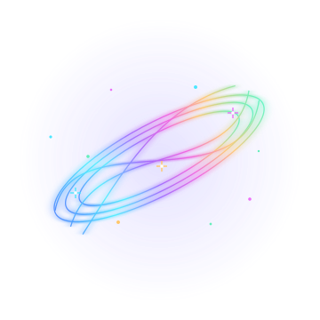

  

## Portfolio

**[Visit my portfolio →](https://parthjaina.vercel.app/)**

Explore ZENO, my voice assistant, and SignSpeak ASL, my browser-based gesture recognition project.

  
  
  

## Hey, I'm Parth 

**AI/ML student · Building intelligent systems**

I'm an AI/ML student who enjoys solving problems and turning ideas into working software. My interests span artificial intelligence, computer vision, voice automation, and full-stack development.

I build across the stack — from models and backend APIs to web interfaces and automation tools — with a focus on making technology useful in everyday life. Alongside my projects, I practice DSA and strengthen my foundations in artificial intelligence and machine learning.

I learn best by experimenting, asking questions, and refining what I build.

 

### In my orbit

<table>
<tr>
<td width="50%" valign="top">

#### 🎙️ [ZENO](https://github.com/parthjaina2107/ZENO)
A Windows assistant for voice and typed commands. Its Dynamic Island shows live playback and task activity, and its dashboard lets you choose which apps and tools it can use.

Python · PySide6 · faster-whisper · Ollama · FastAPI

</td>
<td width="50%" valign="top">

#### 🤟 [SignSpeak ASL](https://github.com/parthjaina2107/signspeak-asl)
Real-time ASL recognition in the browser, using hand landmarks, joint-angle kinematics, and on-device processing.

JavaScript · MediaPipe · WebAssembly

</td>
</tr>
<tr>
<td width="50%" valign="top">

#### 🛡️ [Vigilance](https://github.com/parthjaina2107/Vigilance-SIH2)
Urban road intelligence using transit fleet cameras, edge AI, spatial deduplication, and a WebGIS command center.

Python · YOLOv8 · ONNX · FastAPI · Next.js

</td>
<td width="50%" valign="top">

#### ⚡ [FlowPilot](https://github.com/parthjaina2107/FlowPilot)
Learn-once, replay-anywhere voice automation for Android, built for the Samsung PRISM GenAI Hackathon 3.0.

Kotlin · Python · Android · Voice automation

</td>
</tr>
</table>

### My toolkit

| | Technologies |
| :--- | :--- |
| **Languages** | Python · C++ · C · Java · JavaScript · SQL |
| **AI & vision** | PyTorch · OpenCV · MediaPipe · YOLOv8 · Scikit-learn · Gemini API |
| **Backend & web** | FastAPI · WebSockets · Next.js · REST APIs |
| **Tools** | Git · GitHub · Linux · Docker · VS Code |

<b>A closer look at what I'm building</b>

#### ZENO — voice, context, and everyday work

Ask ZENO to “organize my desktop” and it shows which files it would move, where they would go, and why. It can group screenshots and file older documents, including invoices and receipts, after you approve the plan. You can also open apps, control media, ask about the screen, or review proposed edits in a coding workspace.

ZENO supports local speech recognition and Ollama reasoning, with optional Gemini and online voices. Connect Gmail to search, summarize, draft, and approve messages for sending, or Outlook for read-only inbox previews. On-demand briefings cover notifications, reminders, Git changes, and system health. A paired browser can control playback or request broader actions with approval on the PC.

[Windows installer and setup guide](https://github.com/parthjaina2107/ZENO/blob/main/docs/setup.md)

#### SignSpeak ASL — vision in the browser

MediaPipe landmarks and WebAssembly support on-device gesture recognition. Joint angles, temporal smoothing, and motion tracking help distinguish similar hand shapes and moving gestures.

#### Vigilance — computer vision on the edge

Quantized YOLOv8 detects road distress from transit fleet cameras. Spatial clustering consolidates repeated detections, while repair prioritization and a Next.js WebGIS interface help organize incidents.

 

  Always learning. Always building. One idea at a time. 
  <a href="https://www.linkedin.com/in/parthjaina/">LinkedIn</a> ·
  <a href="mailto:parthjaina.2107@gmail.com">Let's connect</a> ·
  <a href="https://github.com/parthjaina2107?tab=repositories">Explore my work ↗</a>

