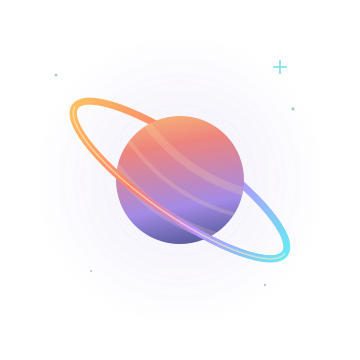

  

  
  
  

## Hey there, I'm Parth 👋

**AI/ML student · Building intelligent systems**

I'm interested in turning AI ideas into useful things — from voice assistants that understand context to computer vision that runs on the edge.

Currently building **[ZENO](https://github.com/parthjaina2107/ZENO)**, exploring **computer vision, deep learning, and intelligent automation**, and sharpening my **DSA and software engineering** skills along the way.

I learn by building, experimenting, and improving one project at a time.

 

### In my orbit

<table>
<tr>
<td width="50%" valign="top">

#### 🎙️ [ZENO](https://github.com/parthjaina2107/ZENO)
Context-aware voice and work assistant with proactive briefings, local speech recognition, and secure mobile control.

Python · Gemini API · FastAPI · faster-whisper

</td>
<td width="50%" valign="top">

#### 🤟 [SignSpeak ASL](https://github.com/parthjaina2107/signspeak-asl)
Real-time ASL recognition in the browser, using hand landmarks, joint-angle kinematics, and on-device processing.

JavaScript · MediaPipe · WebAssembly

</td>
</tr>
<tr>
<td width="50%" valign="top">

#### 🛡️ [Vigilance](https://github.com/parthjaina2107/Vigilance-SIH2)
Urban road intelligence using transit fleet cameras, edge AI, spatial deduplication, and a WebGIS command center.

Python · YOLOv8 · ONNX · FastAPI · Next.js

</td>
<td width="50%" valign="top">

#### ⚡ [FlowPilot](https://github.com/parthjaina2107/FlowPilot)
Learn-once, replay-anywhere voice automation for Android, built for the Samsung PRISM GenAI Hackathon 3.0.

Kotlin · Python · Android · Voice automation

</td>
</tr>
</table>

### My toolkit

| | Technologies |
| :--- | :--- |
| **Languages** | Python · C++ · C · Java · JavaScript · SQL |
| **AI & vision** | PyTorch · OpenCV · MediaPipe · YOLOv8 · Scikit-learn · Gemini API |
| **Backend & web** | FastAPI · WebSockets · Next.js · REST APIs |
| **Tools** | Git · GitHub · Linux · Docker · VS Code |

<b>A closer look at what I'm building</b>

#### ZENO — voice, context, and everyday work

Gemini-powered conversation and a bounded observe–act–verify loop for supported system and file tasks. Work and system briefings bring together notifications, Git changes, reminders, and system health. Local speech recognition, paired devices, and action approvals support desktop and mobile use. Optional inbox connections provide read-only previews.

#### SignSpeak ASL — vision in the browser

MediaPipe landmarks and WebAssembly support on-device gesture recognition. Joint angles, temporal smoothing, and motion tracking help distinguish similar hand shapes and moving gestures.

#### Vigilance — computer vision on the edge

Quantized YOLOv8 detects road distress from transit fleet cameras. Spatial clustering consolidates repeated detections, while repair prioritization and a Next.js WebGIS interface help organize incidents.

 

  Always learning. Always building. One idea at a time. 
  <a href="https://www.linkedin.com/in/parthjaina/">LinkedIn</a> ·
  <a href="mailto:parthjaina.2107@gmail.com">Let's connect</a> ·
  <a href="https://github.com/parthjaina2107?tab=repositories">Explore my work ↗</a>

