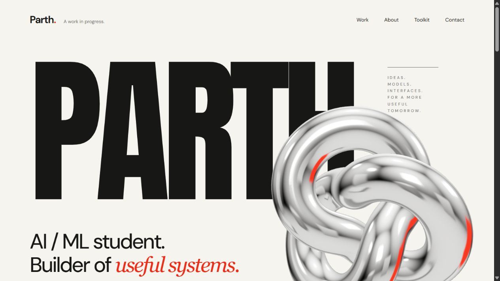

# Parth — Portfolio

My personal portfolio: an introduction to who I am, how I learn, and the systems I build across voice, computer vision, and the web.



## Explore

- My B.Tech in Artificial Intelligence at SRM Institute of Science and Technology (2025–2029), learning interests, and internship goals.
- Project stories for ZENO and SignSpeak ASL, plus expandable details for Vigilance and FlowPilot.
- A polished chrome 3D knot that responds to the mouse, scroll reveals, reduced-motion support, and a pause control.
- A responsive layout, keyboard-accessible project dialogs, and direct email, GitHub, and LinkedIn links.

## Run locally

With Node.js installed, run this from the repository root:

```sh
cd portfolio
npm run dev
```

Then open [localhost:3000](http://localhost:3000).

The site is static; it does not require a package install or build to serve. Three.js and the required Phosphor icons are included in `dist/`, with their licenses. If you prefer Python, serve `portfolio/dist` with `python -m http.server 3000 --directory portfolio/dist` from the repository root.

## Structure

```text
dist/
  index.html        # Content and semantic page structure
  editorial.css    # Responsive layout and motion
  portfolio.js     # Navigation, dialogs, copying, and reveals
  sculpture.js     # Three.js scene and pointer interaction
  component-motion.js / .css # Letter, word, button, and project-preview motion
  assets/          # Project artwork, chrome fallback, and icons
  vendor/          # Three.js modules and license
```

`npm run check` checks the application JavaScript. The package manifest records the upstream library versions; the committed vendor files allow the static site to run without a package install.

## Artwork and credits

The layout was developed from a selected visual concept inspired by editorial portfolios in the [Webflow portfolio collection](https://webflow.com/templates/category/portfolio-and-agency-websites). Project illustrations are conceptual artwork, not application screenshots. See [artwork notes](ARTWORK.md).

- [Three.js](https://threejs.org/) — MIT; real WebGL geometry, materials, and studio reflections.
- [Phosphor Icons](https://phosphoricons.com/) — MIT; interface icons.
- [Google Fonts](https://fonts.google.com/) — Anton and DM Sans. Fonts are requested from Google Fonts; the layout includes system fallbacks.

The chrome studio image remains available if WebGL cannot run. Motion pauses offscreen and in background tabs, and follows the device's reduced-motion preference.

The component interactions were independently implemented for this static site, drawing inspiration from OriginKit's [Scroll Text Reveal](https://www.originkit.dev/components/scroll-text-reveal), [Hover Image Reveal](https://www.originkit.dev/components/hover-image-reveal), and [Masthead Reveal](https://www.originkit.dev/components/masthead-reveal). No OriginKit source code or assets are bundled.
